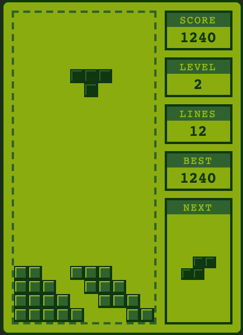
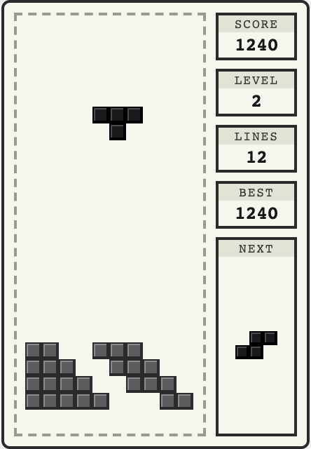
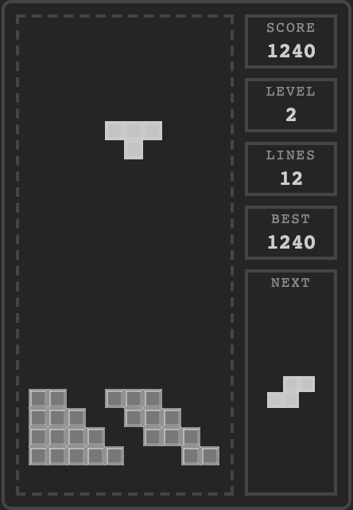

# 俄罗斯方块 · VS Code 扩展

在 VS Code 左侧边栏里玩一局经典俄罗斯方块——Activity Bar 上只是一个叫 `Scratch` 的普通笔记图标，游戏区域置底显示。可选加入在线 TOP10 排行榜。

## 特性

- **藏在侧边栏**：视图贡献到 Activity Bar，图标是普通的笔记样式，游戏区域置底。
- **独立小窗**：需要时可用「在独立窗口打开」把游戏移到浮动编辑器窗口，窗口大小自行拖动；Esc 直接关窗。
- **Game Boy 原版版式**：单色绿屏、左侧 10×22 棋盘、右侧 SCORE / LEVEL / LINES / NEXT 竖向信息框、虚线棋盘边。
- **像素风**：整数像素方块、1px 描边与高光；棋盘自动适配面板高度。
- **消行动画**：被消的行闪白、纵向收缩，上方的行跟着落下。
- **芯片音乐与音效**：Web Audio 实时合成，背景是《Korobeiniki》公版民谣的原创方波改编；旋转、硬降、锁定、消行、升级、失败都有音效。
- **摸鱼友好**：窗口失焦、切编辑器时自动暂停；暂停即隐藏整个侧边栏，只留中性的 Scratch 图标。空闲/暂停时显示一页普通草稿文本。
- **最高分**：保存在 VS Code 的 `globalState` 里，重启后仍在。
- **在线 TOP10（可选）**：匿名 ID + 昵称，默认关闭；开启后游戏结束显示全球排名。

## 皮肤

三套皮肤，通过 `tetris.skin` 切换：

| Game Boy（默认） | 白色 LCD | 透明（跟随主题） |
| --- | --- | --- |
|  |  |  |

## 开始

1. 安装扩展后，按 `Ctrl+Alt+T`（macOS 为 `Cmd+Alt+T`）。
2. 或点击左侧 Activity Bar 上的 `Scratch` 笔记图标。
3. 点一下面板内部让键盘焦点进入 webview，然后开始操作。

## 键位

| 按键 | 动作 |
| --- | --- |
| `←` / `A`、`→` / `D` | 左右移动 |
| `↑` / `W` / `X` | 顺时针旋转 |
| `Z` | 逆时针旋转 |
| `↓` / `S`（按住） | 软降（每格 +1 分） |
| `空格` | 硬降（每格 +2 分） |
| `P` | 暂停 / 继续 |
| `R` | 重新开始 |
| `Enter` | 开始 |
| `Esc` | 暂停并收起，焦点还给编辑器 |

## 命令

| 命令 | 说明 |
| --- | --- |
| `俄罗斯方块: 开始 / 暂停` (`tetris.toggle`) | 打开面板并开始；游戏中再按一次则暂停并回到编辑器 |
| `俄罗斯方块: 重新开始` (`tetris.restart`) | 立即开新的一局 |
| `俄罗斯方块: 清除最高分` (`tetris.resetHighScore`) | 清空本地最高分 |
| `俄罗斯方块: 打开设置` (`tetris.openSettings`) | 跳转到本扩展的设置 |
| `俄罗斯方块: 在独立窗口打开` (`tetris.openWindow`) | 把游戏移到 VS Code 浮动编辑器窗口，内容保持小尺寸 |
| `俄罗斯方块: 查看排行榜` (`tetris.showLeaderboard`) | 查看在线 TOP10；服务器不可用时回退本地 TOP10 |
| `俄罗斯方块: 开启在线排行榜` (`tetris.enableLeaderboard`) | 展示上传字段并写入同意记录 |
| `俄罗斯方块: 设置排行榜昵称` (`tetris.setNickname`) | 修改排行榜昵称 |

## 设置

| 设置项 | 默认值 | 说明 |
| --- | --- | --- |
| `tetris.autoPause` | `true` | 窗口失焦、切换编辑器或收起面板时自动暂停 |
| `tetris.disguise` | `true` | 伪装模式：空闲/暂停时显示草稿页而不是棋盘 |
| `tetris.autoStart` | `false` | 打开面板时直接开始 |
| `tetris.startLevel` | `1` | 起始等级（1–10） |
| `tetris.music` | `true` | 播放背景音乐 |
| `tetris.soundEffects` | `true` | 播放旋转、硬降、消行、升级、失败音效 |
| `tetris.hideSidebarOnPause` | `true` | 暂停/失焦/按 Esc 时直接隐藏整个侧边栏（老板键） |
| `tetris.skin` | `gameboy` | 皮肤：`gameboy` / `light` / `transparent` |
| `tetris.leaderboardEnabled` | `false` | 开启在线 TOP10（machine 级；需通过命令同意上传） |
| `tetris.leaderboardEndpoint` | `""` | 排行榜服务 base URL（必须是 https；本机调试可 `http://127.0.0.1`） |
| `tetris.leaderboardNickname` | `""` | 排行榜昵称，最多 24 个字符；留空使用匿名名字 |

> 浏览器要求音频由用户手势解锁：第一次按键或点击面板后才会出声。

## 在线排行榜（可选）

默认关闭。开启后，所有把 `tetris.leaderboardEndpoint` 指向同一个服务的人共用一个 TOP10。

1. 把仓库里的 [`server/`](https://github.com/luhaifeng666/vscode-tetris/tree/main/server) 部署到你的服务器，按 `server/README.md` 配置 HTTPS 反代。
2. 在设置里把 `tetris.leaderboardEndpoint` 设为 base URL，例如 `https://your-domain/tetris-api`。
3. 运行命令 **「俄罗斯方块: 开启在线排行榜」**，确认上传字段。
4. 完成一局后遮罩会显示排名；用 **「查看排行榜」** 查看在线 TOP10，服务器不可用时自动回退本地 TOP10。

排行榜三项设置都是 **machine 级**：仓库里的 `.vscode/settings.json` 无法替你开启上传或修改 endpoint。更换 endpoint 后必须重新确认。

## 开发

```bash
pnpm install
pnpm check       # 类型检查
pnpm test        # 纯逻辑单元测试
pnpm test:server # 排行榜服务端测试
pnpm compile     # 构建 dist/extension.js、dist/webview.js、dist/webview.css
pnpm smoke       # 用 vscode 桩加载打包产物跑一遍 activate()
pnpm package     # 生成 .vsix
pnpm smoke:vsix  # 校验 .vsix 内容
```

调试：在 VS Code 里打开本目录，按 `F5` 启动扩展开发宿主。

## 隐私

默认不联网。只有你**显式开启在线排行榜并同意**后，扩展才会把以下字段发送到你配置的服务器：

- 随机玩家 ID、昵称
- 分数、消行数、等级
- 扩展版本、提交时间（服务端记录）

不会上传棋盘、输入、代码、文件、GitHub/微软账号、机器名或 IP（服务端不落库 IP）。关闭 `tetris.leaderboardEnabled` 后不会再发起任何请求。在线榜是娱乐性质，分数由客户端上报，可能被伪造。

## 说明

- 「Scratch」只是本扩展自有面板的中性标题，扩展在 Marketplace 上如实标注为俄罗斯方块游戏，不会冒用 VS Code 内置视图的名称。
- 背景旋律《Korobeiniki》是俄罗斯民谣（公有领域），本项目使用自己编写的方波编曲，不包含任何商业游戏录音或编曲。
